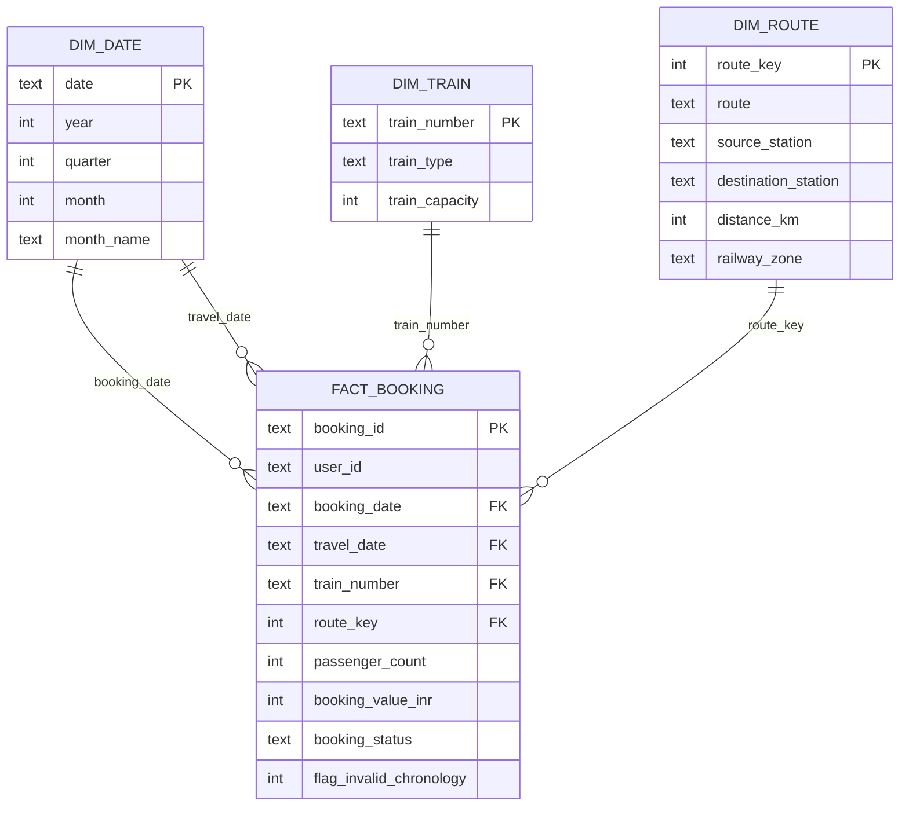
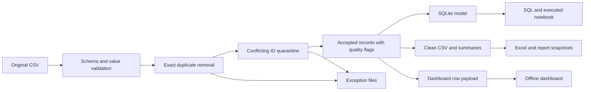

# Analytical data model

The fact table contains one accepted booking ID per row. Exact duplicates and conflicting identities have separate, traceable exception files and are excluded from the fact table. Chronology anomalies remain in the fact with flags.

The diagram shows the main fields. `sql/schema.sql` is the complete generated schema and `DATA_DICTIONARY.md` defines the analytical columns.

## Grain decisions

- **Train.** All 540 source train numbers have multiple names and routes. Type and capacity are consistent per number, so only those attributes enter `dim_train`. A first-match name lookup would fabricate a relationship.
- **Route.** Route label, stations, distance and zone are consistent for this file. The pipeline verifies that relationship before building the dimension.
- **Date.** The calendar spans the source's date range. SQLite enforces both booking and travel foreign keys. The native Power BI model includes an active booking-date relationship and an inactive travel-date relationship to its 365-day DimDate calendar. Both are single-direction, one-to-many. The separate manual import example explains the active relationship; it is not needed to open the native project.
- **User.** User ID is a degenerate identifier on the fact. There are no customer profile attributes to justify a separate customer dimension. The offline dashboard uses a stable dense anonymous key preserving user equality within the source.
- **Operational fields.** Occupancy and delay remain at record grain. Conflicts within train/date combinations prevent treating these rows as authoritative train-service observations.

## Lineage

Source row numbers preserve traceability into the original CSV. Recorded values reconcile through each exclusion stage; valid-lead-time measures use a separate denominator. Integer INR amounts prevent floating-point drift in financial totals.
